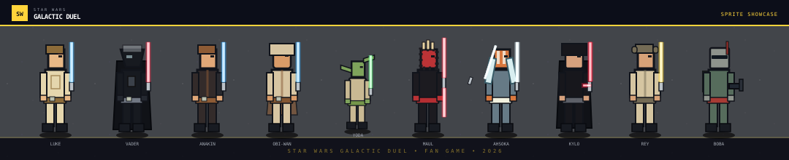

# Galactic Duel

<p align="center">
  <strong>Um jogo de luta arcade em pixel art, ambientado em uma galáxia muito, muito distante.</strong>
</p>

<p align="center">
  
</p>

## Sobre

**Galactic Duel** é um fan game de luta 1 × 1 com personagens, arenas e golpes especiais inspirados no universo de Star Wars. Escolha seu combatente, configure a CPU e vença o duelo usando movimentação, defesa e o poder da Força.

O projeto foi construído sem engine externa: os lutadores e suas animações são desenhados em CSS e controlados por React.

## Destaques

- 10 lutadores, cada um com visual, arma e super próprios;
- 4 arenas: Mustafar, Hoth, Endor e Estação Imperial;
- 4 níveis de dificuldade para a CPU;
- combate com vida, barra de Força, defesa, salto, agachamento e combo;
- interface e efeitos visuais em estilo pixel art.

## Como jogar

1. No menu, selecione **Iniciar batalha**.
2. Escolha o lutador do Player 1.
3. Clique em **CPU** no retrato de outro personagem para definir o oponente.
4. Selecione arena e dificuldade.
5. Pressione **Entrar na batalha**.

### Controles

| Ação | Tecla |
| --- | --- |
| Mover para trás / frente | `A` / `D` ou `←` / `→` |
| Agachar | `S` ou `↓` |
| Pular | `W`, `Espaço` ou `↑` |
| Atacar | `J` |
| Defender | `K` |
| Usar super | `L` |

Acertar golpes carrega a barra azul de **Força**. Ao chegar a 100%, pressione `L` para usar o golpe especial do personagem.

Os comandos foram organizados para serem usados com as duas mãos: a esquerda controla movimento com `WASD`, enquanto a direita usa `J`, `K` e `L` para lutar.

## Lutadores

| Lutador | Super |
| --- | --- |
| Luke Skywalker | Nova Esperança |
| Darth Vader | Asfixia da Força |
| Anakin Skywalker | Fúria do Escolhido |
| Obi-Wan Kenobi | Terreno Elevado |
| Yoda | Turbilhão Ataru |
| Darth Maul | Dança de Dathomir |
| Ahsoka Tano | Caminho de Fulcrum |
| Kylo Ren | Ruptura Instável |
| Rey | Todos os Jedi |
| Boba Fett | Chuva de Beskar |

## Dificuldades da CPU

| Nível | Comportamento |
| --- | --- |
| **Easy** | Reage devagar, causa menos dano e defende pouco. |
| **Normal** | Experiência equilibrada para começar. |
| **Hard** | Mais veloz, agressiva e defensiva. |
| **Hardcore** | Reações rápidas, pressão contínua e uso frequente de especiais. |

## Tecnologias

- React 19 + TypeScript
- Vite 8
- Tailwind CSS 4
- CSS puro para sprites, cenários e animações

## Desenvolvimento local

Pré-requisito: Node.js instalado.

```bash
pnpm install
pnpm dev
```

Para criar a versão de produção:

```bash
pnpm build
```

Também é possível usar os comandos equivalentes com `npm`.

## Organização do projeto

| Caminho | Responsabilidade |
| --- | --- |
| `src/App.tsx` | Telas, regras do combate, IA e componente dos lutadores. |
| `src/index.css` | Direção visual, sprites em CSS e animações. |
| `public/sprites/` | Guia visual e recursos de referência dos sprites. |
| `public/favicon.svg` | Ícone pixelado da aplicação. |

## Créditos

- [Enzo Toniato](https://github.com/EnzoToniato567)
- [Murilo](https://github.com/Murilo1602)
- [Henrique](https://github.com/HenriqueAlth09)
- [Davi](https://github.com/davi-lm7)

## Aviso legal

Este é um projeto de fã não oficial e sem fins comerciais. Star Wars e seus personagens pertencem aos seus respectivos detentores de direitos. O código, a interface e os sprites deste repositório foram produzidos exclusivamente para fins educacionais e de portfólio.
